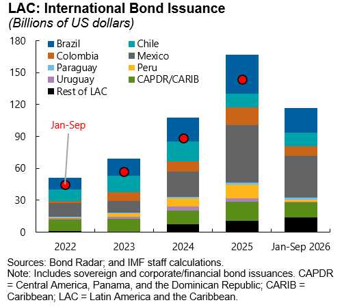
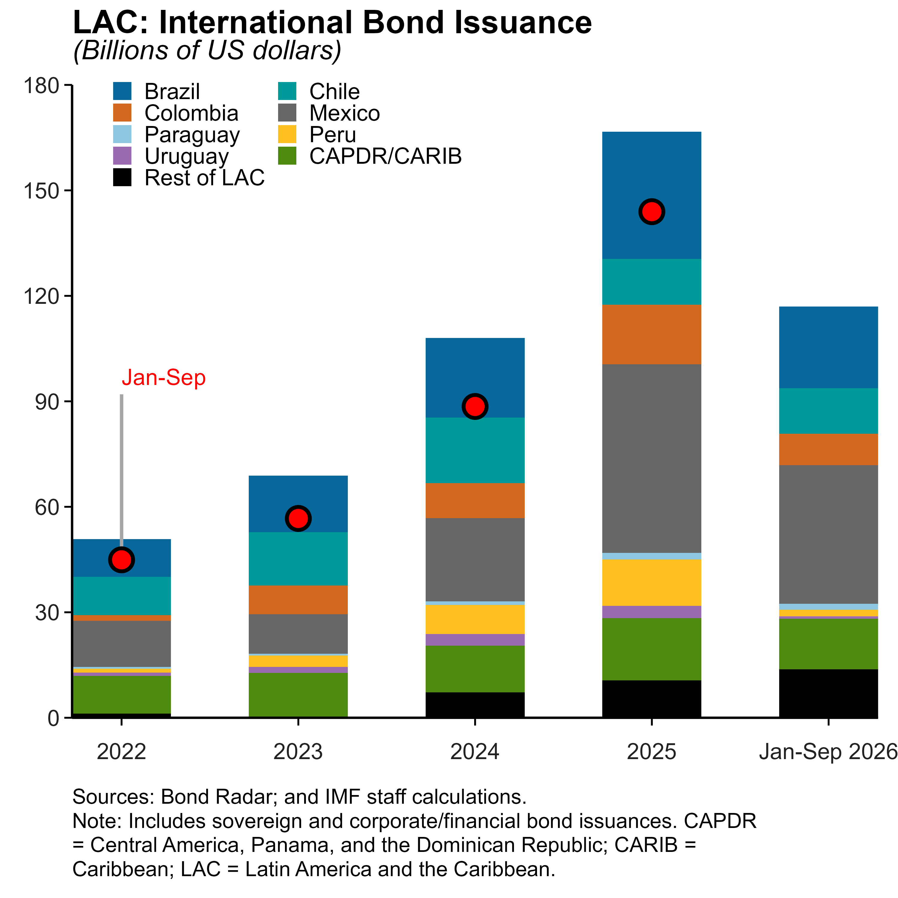

This page follows one chart through the whole pipeline: Figure 2.3 of the October 2026 REO, *LAC: International Bond Issuance*. Its stem is `fig-2-3`. Every file shown here is in the repository.

## The result first

::: {layout-ncol=2}
{#fig-original}

{#fig-converted}
:::

The R version reproduces the data, the stacking order, the colours, the legend, the red markers, the title, the subtitle and the source note. It was produced without anyone writing R by hand.

It is not perfect:

- **The "Jan-Sep" pointer line runs the wrong way.** In the original, a short grey line runs from the label *down* to the 2022 marker. In the R version it starts at the bar and runs up past the label.
- **The last x-axis label, "Jan-Sep 2026", is slightly cut off** at the right edge.

This is typical. The data and the overall chart are right, and a few details need a quick manual touch. Fixing them takes minutes, because the code is short and readable (see [the R code](#the-r-code) below).

## Step by step

### 1. Where the chart lives (step 3)

The File Locator, copied into `chart-list.xlsx`, has this row for the figure:

| Column | Value |
|---|---|
| October 2026 REO Figure | 2.3 |
| File Location | `\\DATA2\WHD\DATA\RS\REO\2026 Fall\Charts\Eurobond Issuance (Sovereign).xlsx` |
| Sheet | `Chart` |
| Chart name in sheet | `Chart 8` |
| Second chart | *(empty: a single chart)* |
| Picture name in this file | `fig-2-3` |

### 2. The picture (step 2)

The published picture is copied from the File Locator into `excel_and_png/fig-2-3.png`. This is the image on the left above. It is what the model is asked to match.

### 3. The data (step 4)

Step 4 opens the source workbook, finds `Chart 8` on sheet `Chart`, reads which cells each of its series uses, and collects those values. The result, `excel_and_png/fig-2-3.xlsx`, has one sheet called `data`:

| category | Rest of LAC | CAPDR/CARIB | Uruguay | Peru | Paraguay | Mexico | Colombia | Chile | Brazil | Jan-Sep |
|---|--:|--:|--:|--:|--:|--:|--:|--:|--:|--:|
| 2022 | 1.15 | 10.72 | 0.99 | 1.10 | 0.50 | 13.11 | 1.62 | 10.94 | 10.73 | 44.92 |
| 2023 | 0.00 | 12.78 | 1.71 | 3.17 | 0.50 | 11.28 | 8.16 | 15.16 | 16.12 | 56.69 |
| 2024 | 7.23 | 13.27 | 3.35 | 8.24 | 1.01 | 23.66 | 9.95 | 18.67 | 22.63 | 88.53 |
| 2025 | 10.66 | 17.68 | 3.49 | 13.16 | 1.92 | 53.63 | 16.95 | 13.03 | 36.19 | 143.94 |
| Jan-Sep 2026 | 13.80 | 14.37 | 0.71 | 1.82 | 1.71 | 39.39 | 8.97 | 12.96 | 23.25 | 116.99 |

*(Rounded here; the file holds the full values.)*

Notice what this table is: exactly the ten series the chart plots, with the column names taken from the chart's legend, and nothing else from the source workbook.

### 4. What Python tells the model about the data (step 6) {#verified-structure}

Before calling the model, step 6 inspects this file and writes a description of it into the prompt. This is the exact text the model received:

```text
Sheet: data
Rows including first row: 6
Columns: 11

Columns exactly as stored, with observed types:
1: name='category'; observed_type=mixed types
2: name='Rest of LAC'; observed_type=numeric
3: name='CAPDR/CARIB'; observed_type=numeric
...
10: name='Brazil'; observed_type=numeric
11: name='Jan-Sep'; observed_type=numeric
```

followed by the first rows of the table.

Two things in it shaped the R code:

- **The exact column names.** Names like `CAPDR/CARIB` and `Jan-Sep` contain characters that need care in R. Because the model was given them exactly, the code uses them exactly instead of inventing tidier names that do not exist.
- **`category` is "mixed types".** It holds four numbers (2022–2025) and one piece of text (`Jan-Sep 2026`). The code therefore converts it to text first (`as.character(category)`) and treats the x-axis as categories, not as a numeric year axis.

### 5. What the model had to work out from the picture

The data alone does not say how to draw the chart. These came from the picture:

- **Nine series are stacked bars, but `Jan-Sep` is not.** It is drawn as red dots with a black outline.
- **There is no dot for "Jan-Sep 2026"**, even though the data has a value for it. The model drew the dots for the first four bars only.
- **The legend order** (Brazil, Chile, Colombia, …) is the reverse of the column order in the data.
- **The colours**, the two-column legend inside the plot area, the bold title, the italic subtitle and the source note.

This is the division of labour from the [overview](index.qmd): Python supplies the facts, and the model supplies the judgement.

Note that the decision to skip the last dot is now built into the code (`slice_head(n = 4)`: "keep the first four rows"). If the data later gains a year, that line has to be updated by hand. Reviewing generated code for such choices is part of checking the result.

### 6. The R code {#the-r-code}

The model returned 165 lines of R, saved as `r_code/fig-2-3.R`. Its structure is what any economist writing the chart by hand would produce:

```r
library(readxl); library(ggplot2); library(dplyr); library(tidyr)

workbook_path <- "k:/excel_and_png/fig-2-3.xlsx"        # the extracted data

plot_data <- read_excel(workbook_path, sheet = "data") %>%
  mutate(category = as.character(category))           # "mixed types" → text

series_order <- c("Brazil", "Chile", "Colombia", "Mexico", "Paraguay",
                  "Peru", "Uruguay", "CAPDR/CARIB", "Rest of LAC")

bar_data <- plot_data %>%                               # wide → long for ggplot
  pivot_longer(all_of(series_order), names_to = "series", values_to = "value")

marker_data <- plot_data %>%                            # the red dots
  slice_head(n = 4) %>%
  transmute(category, value = `Jan-Sep`)

series_colors <- c(Brazil = "#08679B", Chile = "#009999", ...)   # read off the picture

chart <- ggplot(bar_data, aes(category, value, fill = series)) +
  geom_col(width = 0.56) +
  geom_point(data = marker_data, aes(category, value), inherit.aes = FALSE,
             shape = 21, size = 3.6, fill = "red", colour = "black") +
  scale_fill_manual(values = series_colors) +           # colours from the picture
  scale_y_continuous(limits = c(0, 180), breaks = seq(0, 180, 30)) +
  labs(title = "LAC: International Bond Issuance",
       subtitle = "(Billions of US dollars)", caption = "Sources: Bond Radar; ...") +
  theme_classic(base_family = "Arial", base_size = 9)   # + detailed theme settings

ggsave("k:/r_code/figures/fig-2-3.png", chart, dpi = 600, width = 5, height = 5)
```

This is a shortened version. The [full script is on GitHub](https://github.com/BasBBakkerIMF/OpenAI-API-convert-charts/blob/main/r_code/fig-2-3.R).

### 7. Running it (step 7)

`runall.R` sources `fig-2-3.R` along with all the other charts, and it writes the image shown on the right at the top of this page.

## What this example shows

- **The pipeline gets the data right by construction.** The values are read from the cells the Excel chart uses, so there is nothing for the model to get wrong there.
- **The model gets the appearance mostly right.** Small details can be off, and the comparison side by side makes them easy to spot.
- **The output is ordinary, readable R.** Fixing the details, or updating the chart for the next REO, is a normal R editing job.
